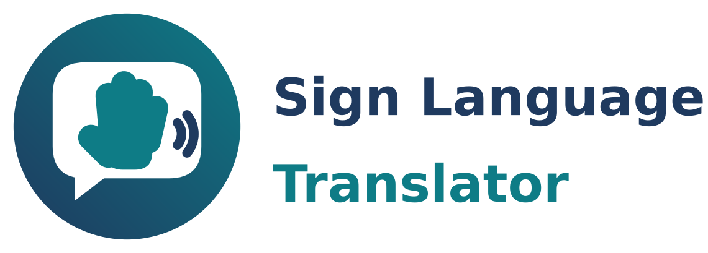
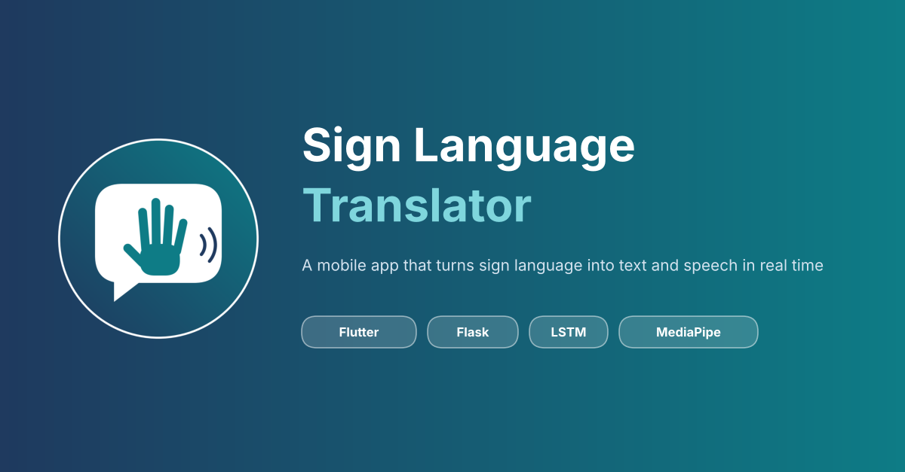
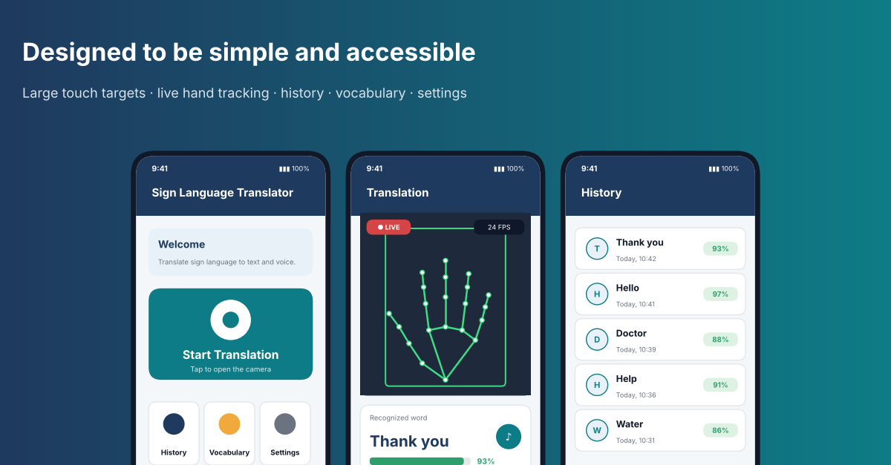
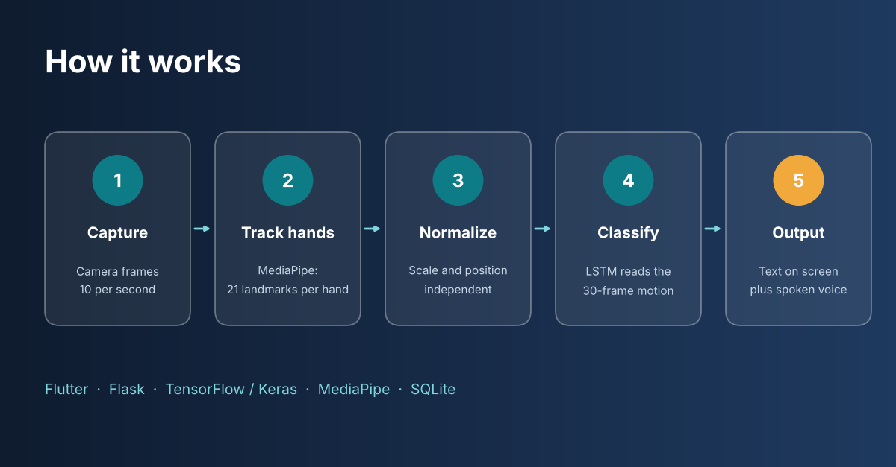
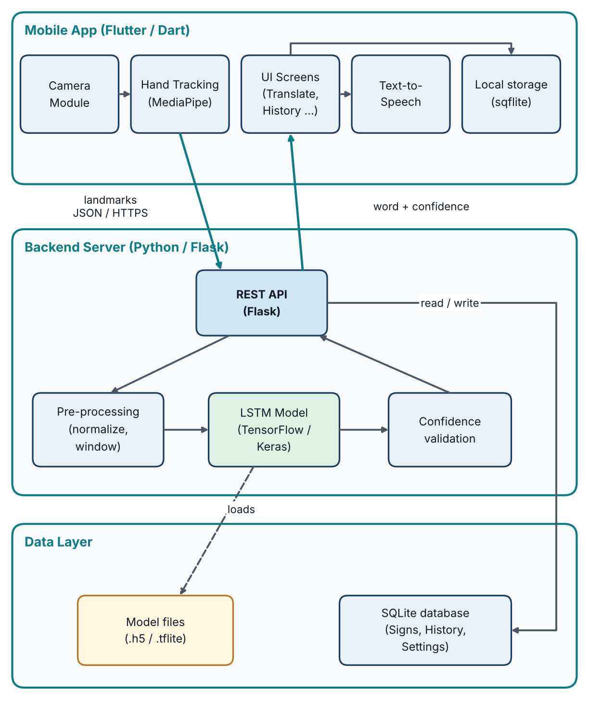

<div align="center">



# Sign Language Translator

**A mobile app that translates sign language into text and speech in real time.**

Flutter · Flask · TensorFlow (LSTM) · MediaPipe · SQLite

</div>

---

## The idea in one sentence

Point the phone camera at a person who is signing, and the app writes the word on the screen and says it out loud,
so a hearing person can understand without needing an interpreter.



## The problem

Deaf and hard-of-hearing people rely on sign language, but most hearing people do not know it. In places such as
hospitals, schools and government offices, this creates a real barrier:

- Human sign language interpreters are few, expensive and not always available.
- Misunderstandings in critical moments (for example, describing pain to a doctor) can have serious consequences.
- Deaf people often cannot handle simple daily tasks independently and need a third person to help.

## The solution

This project is an end-to-end prototype of a smartphone app that acts as a **pocket interpreter** for simple, common
signs. It does not replace human interpreters. It gives deaf people a quick way to say essential words and phrases to
anyone, anywhere, using only a phone.

### A typical conversation

1. A deaf patient arrives at a clinic reception. The receptionist does not know sign language.
2. The receptionist opens the app and points the camera at the patient.
3. The patient signs **"Doctor"**, then **"Pain"**.
4. The app shows **Doctor** and **Pain** on the screen and speaks them out loud.
5. The receptionist understands and calls a nurse. Each recognized word is saved in the history.

### Who benefits

| Group | How they benefit |
|---|---|
| Deaf and hard-of-hearing people | Communicate with hearing people without an interpreter |
| Hospitals and clinics | Faster, clearer communication between staff and deaf patients |
| Schools and universities | Support for deaf students in classrooms and offices |
| Public services | Easier access to everyday services for everyone |
| Learners | Browse the vocabulary and practice signs |

## Why this approach

- **Hand landmarks instead of raw video.** The app does not try to understand pixels. A hand-tracking model finds 21
  key points on each hand (wrist and finger joints) and the AI works only on those points. Background, lighting and
  skin tone matter much less, and the data is small and fast to process.
- **A sequence model (LSTM) instead of a single photo.** Many signs are defined by *movement*, not just hand shape.
  An LSTM reads about 30 frames in order, so it can learn motion over time.
- **A confidence threshold.** The app speaks a word only when the model is at least 80% sure. A wrong translation in
  a hospital is worse than asking the person to sign again.
- **Privacy by design.** Video is not stored. Frames are used only to produce the current prediction.
- **A limited, carefully chosen vocabulary first.** A small set of useful words (greetings, yes/no, medical words)
  that works reliably is more valuable than a huge vocabulary that works badly. Adding words is just recording
  more data and retraining.

## Features

- Live camera preview with hand tracking
- Recognition of a fixed vocabulary (8 words in this version, easy to extend)
- Result shown as large text and spoken aloud (English and Arabic voices)
- Translation history stored on the phone
- Vocabulary screen with search and categories
- Settings: voice language and speed, text size, confidence threshold, dark mode, server address
- Sentence building and a practice quiz in the interactive prototype
- Full documentation (40 pages, 25+ diagrams) and a clickable prototype

## Screens



Splash, Home, Translation, History, Vocabulary and Settings. The full UI design is in
`docs/Sign_Language_Translator_UI_Screens.pdf`.

## How it works



1. **Capture:** the app records camera frames at about 10 FPS and collects about 20 of them (around 2 seconds).
2. **Send:** frames are resized, encoded as JPEG and sent to the Flask API (`/api/predict_images`).
3. **Track hands:** MediaPipe extracts 21 landmarks per hand (x, y, z), giving 2 x 21 x 3 = **126 values per frame**.
4. **Normalize:** coordinates are made relative to the wrist and scaled by the wrist-to-middle-knuckle distance, so
   distance from the camera and position in the frame matter less. The sequence is resampled to exactly **30 frames**.
5. **Classify:** an LSTM network reads the 30 x 126 sequence and outputs a probability for every word.
6. **Validate:** the result is accepted only if confidence is at least **0.8** (configurable). Otherwise the app shows
   "Not recognized" and saves nothing.
7. **Output:** the word is shown, spoken, and saved to the history.

```
Camera -> JPEG frames -> Flask -> MediaPipe (126 values/frame) -> Normalize -> 30 frames
       -> LSTM -> confidence >= 0.8 ? -> word + voice + history
```

### System architecture



### Model

```
Input (30 x 126)
  -> LSTM (64, return_sequences=True)
  -> LSTM (128)
  -> Dense (64, ReLU)
  -> Dropout (0.3)
  -> Dense (N classes, Softmax)
```

Training: Adam (lr 0.001), early stopping, batch size 32, data split 70% train / 15% validation / 15% test,
with light augmentation (jitter, scale, time shift).

## Tech stack

| Layer | Technology |
|---|---|
| Mobile app | Flutter, Dart, Provider, camera, flutter_tts, sqflite |
| Backend | Python, Flask, SQLite, Gunicorn |
| AI | TensorFlow / Keras (LSTM), MediaPipe Hands, OpenCV, NumPy, scikit-learn |
| Testing | pytest, flutter_test |
| CI | GitHub Actions |

## Project structure

```
sign_language_translator/
├── backend/            Flask API, pre-processing, predictor, SQLite access
│   └── data/           vocabulary.json (words, Arabic labels, categories)
├── ml/                 data collection, landmark extraction, training, evaluation, TFLite export
├── mobile_app/         Flutter app (lib/, test/, pubspec.yaml, setup notes)
├── models/             trained model + labels (demo model, see the notes below)
├── tests/backend/      pytest tests
├── reports/            evaluation output (classification report, confusion matrix)
├── docs/               documentation PDF, UI screens PDF, prototype, images
└── .github/workflows/  CI pipeline
```

## Getting started

### 1. Run the backend

Python 3.10 or 3.11 is recommended.

```bash
python -m venv .venv
source .venv/bin/activate          # Windows: .venv\Scripts\activate
pip install -r backend/requirements.txt
python -m backend.app              # http://0.0.0.0:5000
```

Check it: <http://localhost:5000/api/health>

Production: `gunicorn -w 2 -b 0.0.0.0:5000 "backend.app:create_app()"`
Change the threshold: `THRESHOLD=0.85 python -m backend.app`

### 2. Run the mobile app

Install Flutter, then follow `mobile_app/android_notes/SETUP.md` (camera and internet permissions, platform folders).

```bash
cd mobile_app
flutter pub get
flutter run
```

Set the server address in **Settings > Server address**:
- Android emulator: `http://10.0.2.2:5000` (default)
- Real phone: `http://<your-computer-ip>:5000` (same Wi-Fi network)

## API reference

| Method | Endpoint | Description |
|---|---|---|
| GET | `/api/health` | Server status and whether the model is available |
| GET | `/api/signs` | Supported vocabulary (English, Arabic, category) |
| POST | `/api/predict` | Predict from landmark frames: `{"frames": [[126 values], ...]}` |
| POST | `/api/predict_images` | Predict from base64 JPEG frames: `{"images": ["...", ...]}` |
| GET | `/api/history` | Saved recognized words (newest first) |
| DELETE | `/api/history` | Clear the history |

Example response:

```json
{ "label": "Thank you", "confidence": 0.93, "recognized": true, "threshold": 0.8 }
```

When confidence is below the threshold, `label` is `null` and `recognized` is `false`.

## Training your own model

The included model is only a demo (see the notes below). To train on real signs:

```bash
python ml/collect_data.py --word Hello --count 50     # webcam: SPACE records a sample, Q quits
# or convert existing videos (data/videos/<Word>/*.mp4):
python ml/extract_landmarks.py --videos data/videos --out data/raw

python ml/train.py --data data/raw                    # train
python ml/evaluate.py                                 # report + confusion matrix in reports/
python ml/export_tflite.py                            # optional, for future on-device use
```

Tips: record 50 to 100 samples per word, from different people, lighting conditions and backgrounds.
To change the vocabulary, edit `backend/data/vocabulary.json` and retrain.

## Testing

```bash
python -m pytest -q            # 15 backend tests (pre-processing, API, model smoke tests)
cd mobile_app && flutter test  # model tests
```

The CI workflow (`.github/workflows/ci.yml`) trains the demo model and runs the backend tests on every push,
and runs `flutter analyze` and `flutter test` for the mobile app.

## Documentation and prototype

| File | Content |
|---|---|
| `docs/Sign_Language_Translator_Documentation.pdf` | Full project documentation (requirements, design, UML, ER, sequence and data-flow diagrams, testing, timeline, cost, risks) |
| `docs/Sign_Language_Translator_UI_Screens.pdf` | UI design of all screens |
| `docs/sign_language_translator_prototype.html` | Clickable prototype (open in a browser). The AI and hand tracking are simulated |

## Important notes and limitations

- **The included model is a demo.** `models/sign_model.keras` was trained on **synthetic** landmark data
  (`ml/make_demo_data.py`) only to prove that the pipeline works end to end. Its near-perfect test accuracy says
  nothing about real sign language. A real dataset is required before using it with real users.
- **No real-world accuracy has been measured yet**, because no real dataset was available.
- The Flutter app was written but has not been compiled or run on a device in the environment that produced it;
  expect small fixes on the first `flutter analyze` / `flutter run`.
- Vocabulary is limited to 8 words. Full sentences and sign language grammar are not supported.
- Frames are processed on the server, so a network connection is required.
- Sign languages differ between countries and regions. The vocabulary should be validated with sign language specialists.
- This app is an aid for simple communication, not a replacement for professional interpreters, especially in
  medical or legal situations.

## Roadmap

- [ ] Record a real dataset with sign language specialists and measure real accuracy
- [ ] Expand the vocabulary to hundreds of words
- [ ] On-device inference with TFLite (offline mode)
- [ ] Sentence-level translation
- [ ] Facial expression and body movement recognition
- [ ] Reverse translation: text and speech to sign animation
- [ ] Support for multiple sign languages
- [ ] User testing with the deaf community

## Author

**Eng. Amira Abd El-Rahman Saqr**
